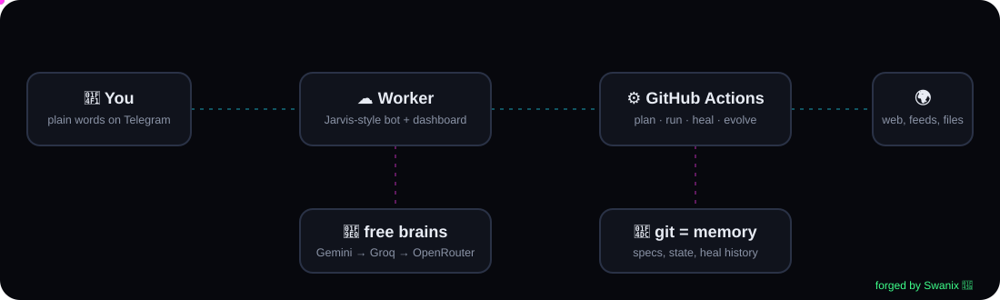

<!-- ⚒ NIXFORGE — forged by Swanix 🐸 -->
<p align="center">
  
</p>

<p align="center">
  
  
  
  
</p>

<p align="center"><b>Tell it what you want automated, in plain words.<br/>NIXFORGE forges the workflow, runs it on schedule, fixes its own breakages, and only asks you before it evolves.</b></p>

<p align="center">
  
</p>

---

## ⚡ What it feels like

```text
you  ▸ ping me whenever the top story on Hacker News changes, every 30 min
forge▸ ⚒ Forged: Watch top story on Hacker News
       ⏰ */30 * * * *  ·  fetch → select → diff → telegram
       🧪 dry run passed (auto-fixed while forging)
       [ ✅ Approve ]  [ 🗑 Discard ]
you  ▸ ✅
forge▸ ✅ Approved. It's live.
       …three weeks later HN changes its HTML. You hear nothing.
       NIXFORGE sees the break, diagnoses it, patches the selector,
       tests the fix in a sandbox branch, promotes it. Still running.
forge▸ 🧬 Evolution pitch E1: add a headless-browser block
       Why: 2 of your requests needed JavaScript-rendered pages.
       [ ✅ Evolve ]  [ ✋ Not now ]
```

Real run from the first forge test — the planner guessed an old Hacker News selector, and the healer fixed it before the plan ever reached the owner:

```text
🩹 fresh forge stumbled (selector 'a.storylink' matched nothing); healing before pitching it
🧠 diagnosis: The CSS selector a.storylink no longer matches the top story link on Hacker News
⚒  forged hn-top-story-watch: dry run passed (auto-fixed while forging)   →  css: span.titleline > a
```

## 🏗 How it's built

<p align="center"></p>

| Part | Lives on | Job |
|---|---|---|
| **Voice** (`worker/`) | Cloudflare Worker (free) | Jarvis-style Telegram bot, understands plain words, live dashboard |
| **Planner** (`forge/planner.py`) | GitHub Actions | plain words → `workflows/<id>/spec.yaml`, dry-runs it, heals it, asks you to approve |
| **Runner** (`forge/runner.py`) | GitHub Actions cron (every 15 min) | runs what's due, retries every outside call ×3, then a fallback |
| **Healer** (`forge/healer.py`) | GitHub Actions | the phoenix loop below |
| **Evolver** (`forge/evolve.py`) | GitHub Actions, weekly | pitches upgrades to itself, builds them only after you tap ✅ |
| **Brains** (`forge/llm.py`) | free tiers | Gemini → Groq → OpenRouter, falls through on any error |
| **Memory** | git | specs, state, run history, every heal as its own `heal/*` branch |

## 🔥 The phoenix loop (self-healing)

<p align="center"></p>

1. A step fails → the runner saves a report with the error, the traceback and **evidence** (for a broken selector: a compact map of the live page).
2. A free LLM diagnoses it and returns a patched spec.
3. **Safety gate**: a heal may change *how* a step works (selectors, URLs on the same site, parsing, tests). It can **never** add or retarget messages, change the schedule, add secrets, or call anything banned.
4. The patch runs in a **sandbox dry run** (no messages, no state writes) with the workflow's own tests.
5. Pass → pushed as `heal/<id>-<n>`, merged to `main`, re-run for real. That first real run is **probation**: if it fails, the fix auto-reverts.
6. Hard caps: 3 tries per incident, 10 per day. Out of tries → roll back to the last green version, cool down 6 h, try again. Broken 3 days straight → pause quietly and pitch an evolution if a missing capability is the cause.

**It never pings you about errors.** That's the deal.

## 🧬 Evolution — only with your nod

Healing fixes what exists. **Evolving** adds what doesn't: a new block, a better version of itself. NIXFORGE pitches it first:

> 🧬 **Evolution pitch E3: RSS → audio briefing**
> **Why:** you asked twice for spoken digests; no block can do TTS yet.
> **What changes:** new `tts` block using a free voice API, with fallback.
> **Risk:** free TTS is flaky; falls back to text.
> `[ ✅ Evolve ]  [ ✋ Not now ]`

Pitches come from requests it couldn't do yet, workflows broken for days, and a **weekly self-review** (Sunday 09:00 IST). On ✅ it writes the block into `forge/blocks_ext/`, safety-checks it, runs its self-test, bumps `VERSION`, and signs the `CHANGELOG`. Fail → rolled back, nothing changes.

## 🛡 Safety, in code (not in prompts)

- **No block exists** to spend money, post publicly, message other people or delete data, so no workflow can do it, planned or healed.
- Telegram only ever talks to **your** chat ID. The bot ignores everyone else.
- Custom/evolved code can't use `subprocess`, sockets, `os.remove`, `requests.post`, `eval`… (`forge/safety.py`).
- Secrets live only in GitHub Secrets / Cloudflare secrets, never in specs, logs or prompts. Specs are scanned for key-shaped strings.
- Every change (yours, a heal, an evolution) is a signed git commit: `Forged-by: Swanix <nixforge>`. Full history, one-click revert.

## 🚀 Light the forge (≈10 min, phone-friendly)

In a GitHub Codespace, from this folder:

```bash
bash setup.sh
```

It asks for a new Telegram bot token (@BotFather → `/newbot`), any free AI keys you have (Gemini / Groq / OpenRouter) and a Cloudflare *Edit Workers* token. Then it creates the repo, sets secrets, deploys the Worker, wires the bot, and runs the **heal demo**: a workflow broken on purpose that fixes itself and messages you.

**If a step trips:**
- Only the bot/dashboard failed? Run `bash scripts/worker.sh`. It redoes just the Cloudflare Worker. Add `CLOUDFLARE_ACCOUNT_ID=<id>` in front if your token lives on a different Cloudflare account.
- Wrangler says *register a workers.dev subdomain*: claim one once at Cloudflare → Workers & Pages, then rerun.
- `HTTP 403 … workflow dispatch`: the Codespace's built-in token can't start workflows. The scripts now run `gh auth login` for a real one.
- Use an **API token** (Edit Cloudflare Workers template), never the Global API Key.

## 💬 Talk to it

Just type what you want. Or:

| Command | Does |
|---|---|
| `/new <task>` | forge a new workflow |
| `/list` | your workflows |
| `/run <id>` | run one now |
| `/pause <id>` · `/resume <id>` | switch off / on |
| `/logs [id]` | recent runs + self-fixes |
| `/convert <link> <fmt>` | any video/audio link → mp3, mp4, wav, gif… |
| `/status` | forge health |
| `/evolve` | self-review for upgrades |

## 🧱 Starter templates

| Template | What |
|---|---|
| `site-watch` | website change watcher → Telegram (edit URL + CSS selector, `/resume site-watch`) |
| `daily-digest` | 08:00 IST news digest, summarised by the free brains |
| `convert` | send a link, get the converted file back |
| `heal-demo` | broken on purpose. Run it and watch it heal |

A workflow is just YAML — you can write one by hand:

```yaml
id: gate_watch
title: GATE notices
schedule: "*/30 * * * *"
tz: Asia/Kolkata
status: active
steps:
  - id: page
    use: fetch
    with: {url: "https://gate2027.iitg.ac.in/"}
  - id: latest
    use: select
    with: {html: "{{ page }}", css: "ul.notices li"}
  - id: watch
    use: diff
    with: {key: latest, value: "{{ latest }}"}
  - id: ping
    use: telegram
    when: "{{ watch.changed }}"
    with: {text: "🔔 {{ latest }}"}
tests:
  - "len(latest) > 0"
```

**Blocks:** `fetch` · `select` · `rss` · `diff` · `llm` · `telegram` · `convert` · `python` (sandboxed) — plus whatever it evolves.

## 🧭 Honest limits

- Headless Linux + web APIs only: no desktop/GUI apps.
- No logins behind captchas, OTP or phone checks.
- Free quotas: GitHub runs can queue ~20 min and cron on a new repo can take a while to start, so schedules of 15 min+ are realistic. Workers: 100k requests/day.
- Healing fixes code drift and flaky sources. It can't bring back a site that's gone.

## 🗺 Roadmap

- [x] planner · runner · phoenix loop · probation + rollback · evolution pitches · Jarvis bot · dashboard
- [ ] multi-user mode (per-user chats, quotas)
- [ ] bring-your-own model brain (plug in a self-hosted LLM)
- [ ] voice notes in, voice briefings out

---

<p align="center">
<pre align="center">
      ()-()
    .-(___)-.        ⚒  N I X F O R G E
     _<   >_         describe it. forge it. it heals.
     \/   \/
</pre>
<b>forged by Swanix 🐸</b> — leave footprints, not bugs.
</p>
